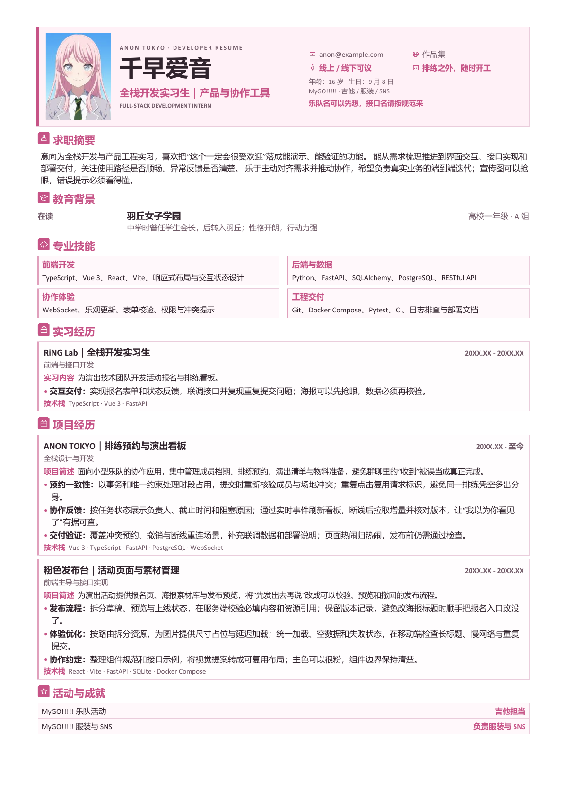
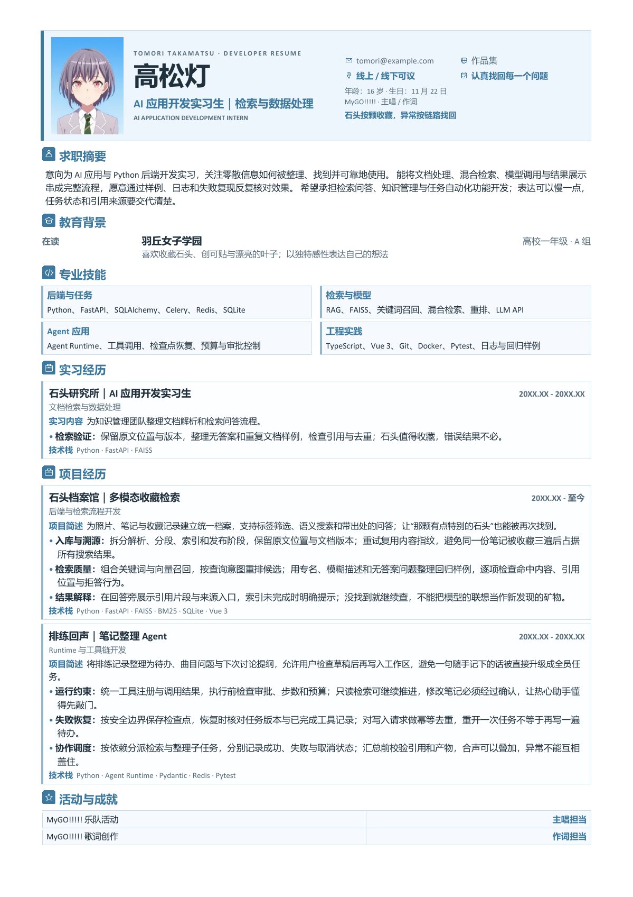
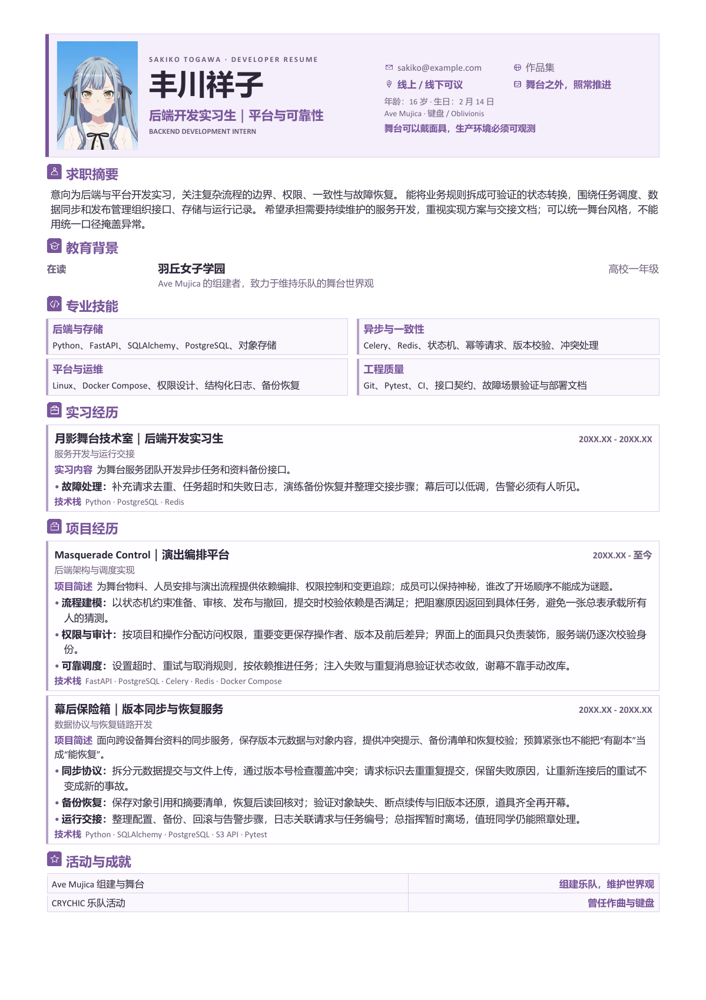

# fastResume

> **“哪怕迷路也没关系，先把简历导出来再说！”** —— 拒绝在 Word 表格的重力场里调格式调一辈子。

要找工作吗！？一修尼！！？（星星眼）

用 Python 把一份 YAML / JSON 配置排成清爽、紧凑的技术简历，一键导出可编辑的 DOCX 和 PDF。统一使用一套高颜值通用模板，姓名、岗位、项目、栏目和主题配色全部由配置文件接管。

版式采用浅色双栏/三栏页眉、带图标的小节标题、分隔技能卡片和带边框的经历卡片；日期自动右对齐，奖项用两列表格工整呈现。**内容填写与版式调整彻底解耦**——经历改了重跑一下就行，再也不用因为多写一行字而导致整页排版“分崩离析”。

## 🎸 三份重力满满的乐队风示例

哪怕乐队天天吵架，找工作时的简历版式也得整整齐齐。同一套生成器，三种截然不同的“人生轨迹”：

| 千早爱音 · 产品与全栈 | 高松灯 · AI 应用与检索 | 丰川祥子 · 后端与平台 |
| --- | --- | --- |
|  |  |  |
| [anon.yaml](examples/anon.yaml) | [tomori.yaml](examples/tomori.yaml) | [sakiko.yaml](examples/sakiko.yaml) |
| 乐队名可以先想（比如 Anon Tokyo），接口名请按规范来。 | 石头和创可贴按颗收藏，线上异常按调用链路找回。 | 舞台上可以戴假面，但生产环境必须 100% 可观测。 |

*注：预览图均在 Windows 上通过 Microsoft Word 实际导出，每份严格压缩在一页以内；点击图片可查看高清大图。*

### 角色梗与版权考据（认真脸）

- **证件照来源**：三份简历的灵魂证件照来自 Bilibili 宝藏 UP 主 [抽象的棋手](https://space.bilibili.com/406245710) 的同人证件照系列；本项目保留原图，仅在生成时按人像焦点智能取景。完整署名与来源见 [照片说明](examples/photos/README.md)。
- **硬核设定还原**：三份角色主题模板使用完全相同的底层版式。学校、年级、生日和乐队担当均严格考据自官方资料，开发经历则融入了原创的“乐队×程序员”技术梗。年龄按高一年级统一推算为 16 岁（是的，16 岁全栈/架构师，恐怖如斯）。联系方式使用虚构的 `example.com`。
- **官方资料指路**：[爱音的学校、年级与生日](https://bang-dream.bushimo.jp/character/mygo/chihaya-anon/)、[爱音的吉他、服装与 SNS 运营分工](https://anime.bang-dream.com/avemujica/character/anon/)、[灯的学校、年级与生日](https://bang-dream.bushimo.jp/character/mygo/takamatsu-tomori/)、[灯的主唱与作词分工](https://anime.bang-dream.com/avemujica/character/tomori/)、[祥子的学校、年级与键盘分工](https://anime.bang-dream.com/avemujica/character/sakiko/)、[祥子的 CRYCHIC 前尘往事](https://anime.bang-dream.com/mygo/character/sakiko/)、[祥子的生日（武士道官方商店）](https://bushiroad-store.com/pages/bd_stargazing_cp)。示例采用简体中文译名，主题印象色为本项目的排版设计选择。
- **活动与成就**：“活动与成就”一栏忠实还原了原作中的乐队实绩，涵盖 MyGO!!!!! 的演出、打歌服设计、SNS 运营（爱音狂喜）与作词工作，以及祥子一手缔造 Ave Mujica 世界观和那段不能说的 CRYCHIC 经历。

## 🚀 开始使用（组建你的简历！）

需要 Python 3.10 或更新版本。先把项目拉到本地：

```bash
git clone https://github.com/KiriAky107/fastResume.git
cd fastResume
python -m pip install -r requirements.txt

```

### 方式一：浏览器可视化编辑（像刷 SNS 一样简单）

不想手搓 YAML 缩进？在项目根目录启动本地 Web 编辑器：

```bash
python scripts/serve.py

```

浏览器打开 [http://127.0.0.1:8765](http://127.0.0.1:8765)。左侧表单直接改姓名、岗位和简介（也可以切到 YAML 源码模式深度微调）；右侧实时预览排版效果，底部一键导出 Word / PDF。

* **随时切号**：支持一键切换通用模板或三份角色示例，点击“＋实习”“＋项目”“＋奖项”按钮即可轻松追加词条。
* **配置防丢**：支持导入已有 YAML / JSON。**刷新或关闭页面前请务必点击“保存 YAML”**（别让心血像某乐队一样突然解散），上传的照片也会自动编码保存在 YAML 中。
* **自带颜值**：可选上传 PNG / JPEG / WebP 证件照（最大 2 MB）。上传后页眉自动切换为“照片 / 姓名与岗位 / 联系信息”三栏模式；移除照片则无缝退回清爽双栏。

> 💡 **安全与环境说明**：编辑器仅监听本机地址（`127.0.0.1`），纯本地运行，绝不把你的退队声明或简历发往任何云端；服务端临时文件随请求自动清理。PDF 导出依赖本机安装的 Word 或 LibreOffice，最终分页以实际导出为准。若默认端口被占，可加上 `--port 8766`，按 `Ctrl+C` 即可优雅谢幕。

### 方式二：命令行硬核构建（客服小祥的工作流）

先复制一份 [通用匿名模板](examples/resume.template.yaml) 作为你的专属底稿。

在 Windows PowerShell 中：

```powershell
Copy-Item examples/resume.template.yaml my_resume.yaml

```

macOS / Linux 用户请用 `cp examples/resume.template.yaml my_resume.yaml`。不用担心泄露隐私，`my_resume.*` 默认已被 `.gitignore` 贴心屏蔽。

**1. 极速导出 Word（无需安装 Office）：**

```bash
python scripts/build_resume.py --source my_resume.yaml --output output/my_resume --formats docx

```

`--output` 指定的是文件名前缀，上述命令会生成 `output/my_resume.docx`。除了 YAML，配置文件也完全支持相同字段结构的 JSON。

**2. 导出 Word + PDF，并开启“一页纸严防死守”检查：**

```bash
python scripts/build_resume.py --source my_resume.yaml --output output/my_resume --formats docx pdf --max-pages 1 --force

```

> ⚠️ **注意**：PDF 转换需要本机安装有 Microsoft Word（Windows）或 LibreOffice（程序不会偷偷帮你装 Office）。由于不同操作系统的字体渲染与转换后端存在差异，**正式投递前请务必像检查演出设备一样，亲自打开生成的 PDF 确认换行与页数**。

## 🎤 复现三份角色示例

三位角色的简历由同一个生成器和同一套数据结构驱动，指定对应的 `--source` 即可召唤：

```bash
python scripts/build_resume.py --source examples/anon.yaml --output output/anon --formats docx pdf --max-pages 1
python scripts/build_resume.py --source examples/tomori.yaml --output output/tomori --formats docx pdf --max-pages 1
python scripts/build_resume.py --source examples/sakiko.yaml --output output/sakiko --formats docx pdf --max-pages 1

```

如果电脑上没装 Office、只想先看 Word 效果，把 `--formats docx pdf --max-pages 1` 换成 `--formats docx` 即可。

## 🛠️ 常用命令行选项

| 参数 | 用途 |
| --- | --- |
| `--source PATH` | 输入的 YAML 或 JSON 配置文件路径 |
| `--output PREFIX` | 输出文件前缀，程序会自动拼接 `.docx` / `.pdf` |
| `--formats docx pdf` | 指定导出格式（Word、PDF 或两者皆要） |
| `--validate-only` | 仅做配置语法与结构校验，不生成实际文件 |
| `--pdf-backend auto|word|libreoffice` | 指定 PDF 转换后端引擎 |
| `--office-path PATH` | 手动指定 LibreOffice 的 `soffice` 可执行文件路径 |
| `--photo PATH` | 本次导出临时挂载的证件照（支持 PNG / JPEG / WebP，最大 2 MB） |
| `--max-pages 1` | 检查 PDF 页数上限（超页会报错提醒，**不会**自作主张删你字或缩字号） |
| `--timeout 120` | PDF 转换超时时间（单位：秒） |
| `--force` | 允许覆盖已存在的同名输出文件；默认拒绝覆盖以防手滑 |

**仅验证配置文件是否合法：**

```bash
python scripts/build_resume.py --source examples/resume.template.yaml --validate-only

```

**Windows 下强制指定使用 LibreOffice 导出：**

```powershell
python scripts/build_resume.py --source examples/anon.yaml --output output/anon --formats pdf --pdf-backend libreoffice --office-path "C:\Program Files\LibreOffice\program\soffice.exe"

```

## 📝 把它改成你自己的简历（写下你的歌词）

配置文件结构清晰直观，按需填空即可：

* `basics` 与 `code`：姓名、求职岗位、到岗状态、联系方式和 GitHub/作品集链接；`basics.details` 可补充自定义页眉信息。
* `profile`：个人简介、求职意向与核心竞争力。
* `education`、`skills`、`project_experiences`：教育背景、分类技能树与项目经历。
* `internship_experiences`、`work_experiences`：独立的实习经历与全职工作经历，字段结构与项目经历完全一致。
* `certificates`、`extra_sections`：获奖证书与自定义扩展栏目（比如开源贡献、乐队演出等）。
* `theme`：纸张大小（A4 / Letter）、主题主色调、字体、字号、行距与页边距微调。

**排版小贴士：**

* **高光加粗**：项目经历用 `description` 概括背景，用 `highlights` 列出你的个人战绩。正文原生支持 Markdown `**粗体**` 语法，且列表项开头的短句（如 `核心职责：`、`性能优化：`）会自动识别并加粗。请如实填写你的真实技术经历——本程序只负责貌美如花地排版，不提供“无中生有”或自动编造项目数据的功能。
* **智能隐藏（防尴尬机制）**：全篇只有 `basics.name` 是必填项。其余可选字段皆可省略、设为 `null` 或留空——清空某条经历会自动隐藏整张卡片；整个栏目没有有效内容时，连同小节标题一起消失；未填写的项目简述或技术栈标签也不会留下一行尴尬的空白。

**关于照片的高级玩法：**
命令行可用 `--photo` 在导出时临时塞入一张证件照：

```bash
python scripts/build_resume.py --source my_resume.yaml --photo portrait.jpg --output output/my_resume --formats docx

```

网页端上传的照片会转为 Data URI 存在 `basics.photo` 里，跟着 YAML 文件走天下；命令行模式也支持填写相对于配置文件目录的图片路径。如果你非要用一张**乐队合照**当证件照（？），可以在 YAML 里通过 `basics.photo_focus: [0.25, 0.5]` 指定裁切框的视觉焦点（X/Y 坐标范围均为 `0`–`1`，默认 `[0.5, 0.5]` 居中裁切，精准框住你想展示的那个人）。

完整的字段说明、主题定制指南及 PDF 排障手册，请参阅 [详细使用说明](docs/resume_generator.md)。

## 🧪 验证与开发

想确认代码有没有跑偏？运行内置的单元测试套件（无需安装 Office）：

```bash
python -B -m unittest discover -s tests -v

```

测试覆盖了配置校验、内容完整性保留、防覆盖保护、异常中断回滚以及 PDF 后端失败降级处理。当然，单元测试管不了 Word 的玄学渲染，PDF 的最终视觉效果仍需在本机转换后肉眼检阅。

**隐私承诺**：本项目 100% 在本地处理你的配置与文档，**绝不调用任何在线简历服务或大模型 API**。导出过程中的临时目录在任务结束（无论成功或失败）后都会被立刻清理，只有最终成片会留在你指定的输出目录里。

## 📄 许可与声明

本项目代码采用 [MIT License](LICENSE) 开源。
示例中所涉角色名称（千早爱音、高松灯、丰川祥子）及《BanG Dream! It's MyGO!!!!!》《BanG Dream! Ave Mujica》原作相关权利均归 Bushiroad 及各权利方所有；本项目与角色示例均为用爱发电的非官方同人/工具作品。祝各位求职顺利，找到属于自己的“一辈子”好Offer！
